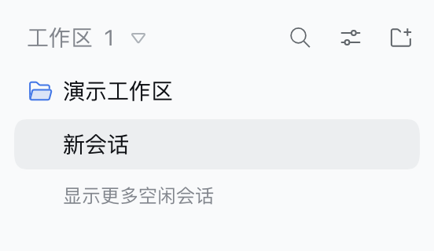
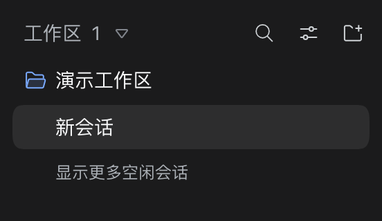

# Three sidebar list modes

[简体中文](README.zh.md)

Select the Workspaces or Sessions heading or its arrow to cycle through **All → Collapsed → Needs attention**.
**All** counts the sessions in the current archive filter.
**Needs attention** counts sessions kept by the filter, not idle sessions revealed manually.
**Collapsed** only counts sessions with activity or drafts.
Hover or focus the heading for the meaning of its count.
**Needs attention** keeps the current session in its usual group and position.
It also keeps pinned sessions and sessions with pending approvals, plan reviews or questions,
ongoing work (including subagents), or unread completions.
It also keeps sessions with unsent drafts when **Session draft** is enabled.
In **Workspace** and **Workspace tree** views, expand a workspace to see its sessions and its own idle-session button.
A workspace keeps its heading while it has a session needing attention or
after you reveal its idle sessions in the current visit to **Needs attention**.
The tree keeps parents needed to reach a visible workspace.
Switch to **All** to browse hidden workspaces.
**Show more idle conversations** reveals up to five at a time in list order.
Once all idle sessions in that workspace are visible, **Show fewer idle conversations** collapses its idle sessions.
The **Ungrouped** section has its own button, and the flat **Sessions** view has one button at the bottom.
Search temporarily shows native results and restores the previous mode when closed.
The next time you enter **Needs attention**, idle conversations start collapsed.
The page starts in **Needs attention**.

Requires DeepSeek Harness 0.2.2-rc.5 or newer. To install from a source checkout,
run `npm ci` there to build the plugin, then select the directory in **Plugins → Add plugin**.
If prompted, restart DeepSeek Harness, then expand the sidebar.
If you installed `@miorin/dsh-workspace-list-toggle` separately, remove it before installing this renamed bundle.
If you use List Atlas, update that bundle instead of installing both.

[Project documentation](docs/README.md)

## Screenshots

**Needs attention** keeps the current session visible and lets you reveal more idle sessions.
The screenshots show the Chinese interface.

| | Light | Dark |
| --- | --- | --- |
| Needs attention view |  |  |
