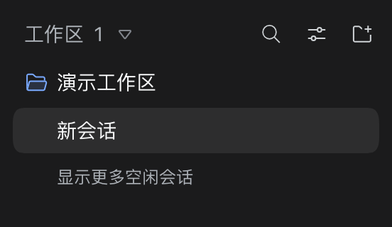

# 左侧栏列表三态切换

[English](README.md)

点击左侧栏「工作区」或「会话」标题（或旁边的箭头），
按 **全部 → 收起 → 需关注** 循环切换（打开或刷新页面默认处于 **需关注**）。

- **需关注** 保留当前会话、置顶会话，以及等待审批/审阅计划/回答、正在运行（含子代理）、
  完成后未读或有未发送草稿（启用「会话草稿」时）的会话；空闲会话默认收起，
  可通过 **显示更多空闲会话** 每次展开最多 5 条。
- **全部** 统计当前归档筛选下的会话数；**收起** 仅统计有活动或草稿的会话；搜索时临时展示原生结果，关闭后恢复先前模式。

需要 DeepSeek Harness `0.2.2-rc.5` 或更新版本。
可在 **列表模块化改良计划** 中直接开启，或在源码目录运行 `pnpm install` 后从 **插件 → 添加插件** 选择本目
录（若曾单独安装 `@miorin/dsh-workspace-list-toggle` 请先移除，勿与聚合包重复安装）。

## 界面截图

| | 浅色 | 深色 |
| --- | --- | --- |
| 需关注视图 |  |  |

[项目文档](docs/README.md)
